## Figures ⏭ 27 Parale (§11)

<!-- u:u02039 kind:table -->
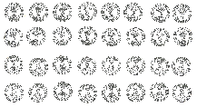

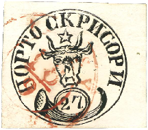

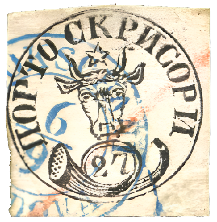

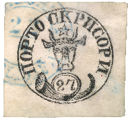

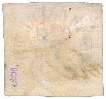

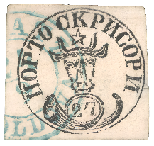

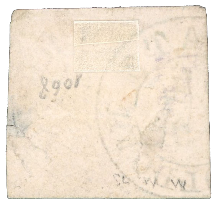

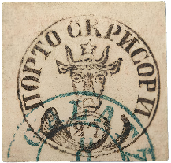

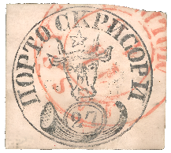

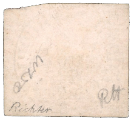

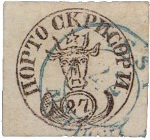

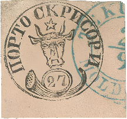

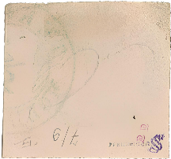

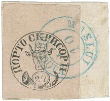

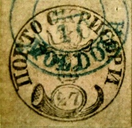

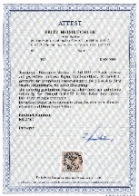

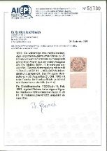

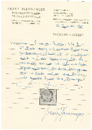

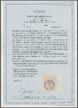

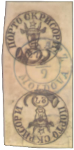

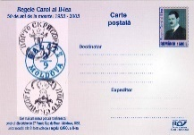

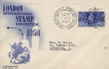

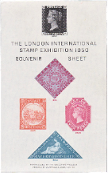

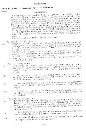

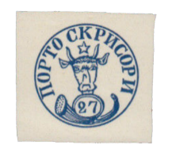

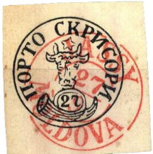

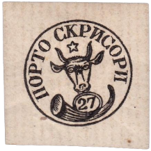

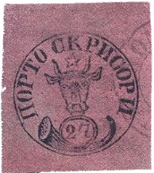

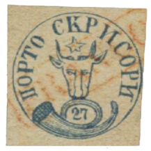

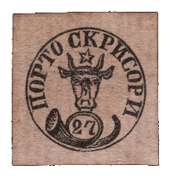

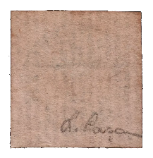

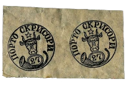

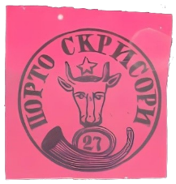

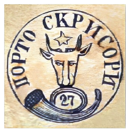

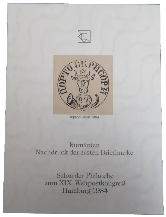

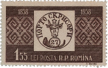

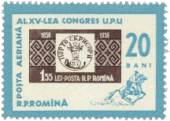

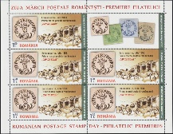

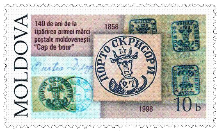

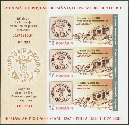

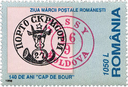

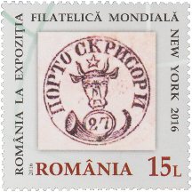

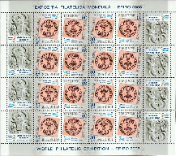

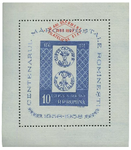

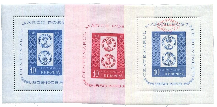

| Table 28: Figures ⏭ 27 Parale (§11) |  |  |  |
|---|---|---|---|
| Figure 190, p.243 | 27 Parale x 32 | ⏭ 📖 Kiriac 1974, Fig 38, p.31 |  |
| Figure 191, p.251 | 27 Parale ⨀ M1 🌍 Iaşi (Jassy) 📅 18/9 | ⏭ 2024-05-01: https://www.davidfeldman.com/dfsa-auctions/2013-september-auction-series/europe-overseas/70793/romania-1858-27-parale-black-on-rose-used-with-red/?soff_session_keywords=70793 |  |
| Figure 192, p.251 | 27 Parale ⨀ M1 🌍 Focşani (Fokschani) 📅 6/9 | ⏭ 2024-05-01: https://www.davidfeldman.com/dfsa-auctions/2013-september-auction-series/europe-overseas/70794/romania-1858-27-parale-black-on-rose-cancelled-by/ |  |
| Figure 193, p.251 | 27 Parale ⨀ M1 🌍 Focşani (Fokschani) 📅 22/9 | ⏭ 2024-05-02: https://www.davidfeldman.com/dfsa-auctions/2022-december/hausman-collection-europe-overseas-latin-america-d/60359/romania-1858-moldavia-27-parale-black-printed-on-r/ |  |
| Figure 193, p.251 | Reverse  ✍ J. Schlesinger |  |  |
| Figure 194, p.252 | 27 Parale ⨀ M1 🌍 Galaţi (Galatz) 📅 24/9 | ⏭ 2024-05-01: https://www.davidfeldman.com/de/dfsa-auktionen/2022-december/hausman-collection-europe-overseas-latin-america-d/60358/romania-1858-moldavia-27-parale-black-printed-on-w/ |  |
| Figure 194, p.252 | Reverse |  |  |
| Figure 195, p.252 | 27 Parale ⨀ M1 🌍 Galaţi (Galatz) 8/? 📅 1858 | ⏭ 2024-05-07: https://www.mediafax.ro/cultura-media/un-timbru-cap-de-bour-27-de-parale-estimat-la-10-000-de-euro-scos-la-licitatie-de-artmark-foto-14723242 |  |
| Figure 195, p.252 | ⏭ 2024-10-13: https://www.artmark.ro/ro/licitatie/licitatia-romania-iluminista-de-la-brancoveanu-la-cuza-171-2015/lot/timbru-cap-de-bour-27-de-parale-1858-piesa-rara-de-colectie-filatelica-insotit-de-certificat-de-autenticitate-ro-93564 |  |  |
| Figure 196, p.253 | 27 Parale ⨀ M1 🌍 Iaşi (Jassy) 📅 14/10 | ⏭2024-06-12: https://www.davidfeldman.com/dfsa-auctions/2022-december/hausman-collection-europe-overseas-latin-america-d/60360/romania-1858-moldavia-27-parale-black-sent-to-gmac/ |  |
| Figure 196, p.253 | Reverse  ✍ Richter |  |  |
| Figure 197, p.253 | 27 Parale ⨀ M1 🌍 Iaşi (Jassy) 📅 1858-??-22 | ⏭ 2024-05-01: https://www.davidfeldman.com/fr/dfsa-ventes/2014-december-auction-series/all-world/52501/romania-superb-used-bulls-head1858-27-parale-black/?soff_session_page=90&soff_auction_browse=1 |  |
| Figure 198, p.254 | 27 Parale ⨀ M1 🌍 Tecuci (Tekutsch) 📅 2/9 | ⏭ 2024-06-12: https://corinphila.ch/en/_auctions/&action=showLot&auctionID=6&lotno=1114# |  |
| Figure 198, p.254 | Reverse  ✍ Thiel ✍ Pfenninger |  |  |
| Figure 199, p.254 | 27 Parale △ ⨀ M1 🌍 Vaslui (Waslui) 📅 22/10  ⏭ 📖 Corinphila 179 | ⏭ 2024-08-30: https://corinphila.ch/en/_auctions/&action=showLot&auctionID=3&lotno=5018# |  |
| Figure 200, p.254 | 27 Parale ⨀ M1 📅 1858-10 | ⏭ 2024-05-06: https://clasate.cimec.ro/Detaliu.asp?tit=timbru--Cap-de-bour-emisiunea-I-27-parale&k=4175AF94AD2546E7BD44010E891D7C2C |  |
| Figure 201, p.255 | 📜 Holcombe 📅 1998 | ⏭ Figure 193, p.251 |  |
| Figure 202, p.255 | 📜 Heimbüchler 📅 2000 | ⏭Figure 194, p.252 |  |
| Figure 203, p.255 | 📜 Bloch 📅 1983 | ⏭Figure 196, p.253 |  |
| Figure 204, p.255 | 📜 Gmach 📅 2022 | ⏭Figure 196, p.253 |  |
| Figure 205, p.256 | 📜 Heimbüchler 📅 1997 | ⏭ Figure 197, p.253 |  |
| Figure 206, p.256 | 📜 Pfenninger 📅 1965 | ⏭ Figure 198, p.254 |  |
| Figure 207, p.256 | 📜 Heimbüchler 📅 2010 | ⏭Figure 199, p.254 |  |
| Figure 208, p.257 | 27 Parale ⨀ M1 🌍 Galaţi (Galatz) 📅 3/9 | ⏭ 2024-05-03: https://www.museumofphilately.com/rarity/198 |  |
| Figure 209, p.257 | Postcard | ⏭ 2024-05-04: https://www.lumea-tiparului.ro/Istoria_timbrului_romanesc-o_adevarata_istorie_a_Romaniei.html |  |
| Figure 210, p.258 | Souvenir cover | ⏭ 2024-05-03: https://www.bfdc.co.uk/1950/souvenir_covers/george_the_dragon.html |  |
| Figure 211, p.258 | Prospect | ⏭ 2024-05-03: https://www.philshop.de/artikel/3537/london-international-stamp-exhibition-1950-prospectus-catalogue |  |
| Figure 212, p.258 | Catalogue | ⏭ 2024-05-03: https://www.philshop.de/artikel/3537/london-international-stamp-exhibition-1950-prospectus-catalogue |  |
| Figure 213, 259 | Ticket | ⏭ 2024-05-04: https://www.gbps.org.uk/information/downloads/philatelic-studies-misc/British%20Stamp%20Exhibitions,%20Vol%201%20Part%201%20Sheets%20etc%20-%20Morgan%20and%20Wilson%20(4th%20Edition%202018).pdf |  |
| Figure 214, p.259 | Souvenir Sheet | ⏭ 2024-05-04: https://en.wikipedia.org/wiki/London_International_Stamp_Exhibition_1950#/media/File:London_International_Stamp_Exhibition_1950_souvenir_sheet.img.jpg |  |
| Figure 215, p.259 | 🌍 Grosvenor House 📅 2022 | ⏭ 2024-05-06: https://www.google.com/maps/place/JW+Marriott+Grosvenor+House+London/@51.509674,-0.1552706,3a,75y/ |  |
| Figure 216, p.260 | Catalogue, p.111 ⏭ Figure 212 | ⏭ 2024-08-30: https://www.ebay.com/itm/256418868802 |  |
| Figure 217, p.261 | 📰 Daily Mirror 🌍 Sydney 📅 1950-05-15 ⏭ p.6 | ⏭ 2024-05-03: https://trove.nla.gov.au/newspaper/article/274122638 |  |
| Figure 218, p.262 | 27 Parale 🆁 Replica | ⏭ 2024-10-13: http://catalogue.klaseboer.com/vol2/html/rumafor2.htm |  |
| Figure 218, p.262 | 27 Parale 🆁 Replica | ⏭ 2024-10-13: http://catalogue.klaseboer.com/vol2/html/rumafor1.htm |  |
| Figure 218, p.262 | 27 Parale 🆁 Replica | ⏭ 2024-10-13: https://www.romaniastamps.com/forg/mol1-27p.htm |  |
| Figure 218, p.262 | 27 Parale 🆁 Replica | ⏭ 2024-10-13: http://catalogue.klaseboer.com/vol2/html/rumafor1.htm |  |
| Figure 218, p.262 | 27 Parale 🆁 Replica | ⏭ 2024-10-13: http://catalogue.klaseboer.com/vol2/html/rumafor2.htm |  |
| Figure 218, p.262 | 27 Parale 🆁 Replica | ⏭ 2024-10-13: https://www.romaniastamps.com/forg/mol1-27p.htm |  |
| Figure 218, p.262 | 27 Parale 🆁 Replica | ⏭ 2024-10-13: http://catalogue.klaseboer.com/vol2/html/rumafor2.htm |  |
| Figure 219, p.263 | 27 Parale 🆁 Replica ⏭ Vertical laid paper (instead of Horizontal laid paper) | ⏭ 2024-08-30: https://www.ebay.com/itm/276538621844 | ⏭ 2024-10-12: link is broken |
| Figure 219, p.263 |  |  |  |
| Figure 220, p.263 | 27 Parale 🆁 Replica ⏭ Modern reproduction | ⏭ 2024-10-12: https://www.worthpoint.com/worthopedia/1858-romania-bull-head-27-par-impref-110386112 |  |
| Figure 221, p.264 | 27 Parale 🆁 Replica ⏭ „Wikipedia-style” | ⏭ 2024-10-12: https://en.wikipedia.org/wiki/Moldavian_Bull%27s_Heads |  |
| Figure 222, p.264 | Figure 222: 27 Parale 🆁 Replica ⏭ „Wikipedia-style” | ⏭ 2024-10-14: https://www.romaniastamps.com/forg/forgeframe.htm |  |
| Figure 223, p.264 | 27 Parale 🆁 Replica ⏭ „Wikipedia-style” | ⏭ Figure 221 |  |
| Figure 224, p.265 | 27 Parale 🆁 Replica ⏭ 📖 Stiedl-Billig  🆁 Type 1 (Fournier) | ⏭ 📖 Stiedl-Billig |  |
| Figure 224, p.265 | 27 Parale 🆁 Replica ⏭ 📖 Stiedl-Billig  🆁 Type 2 | ⏭ 📖 Stiedl-Billig |  |
| Figure 224, p.265 | 27 Parale 🆁 Replica ⏭ 📖 Stiedl-Billig  🆁 Type 3 | ⏭ 📖 Stiedl-Billig |  |
| Figure 224, p.265 | 27 Parale 🆁 Replica ⏭ 📖 Stiedl-Billig  🆁 Type 4 | ⏭ 📖 Stiedl-Billig |  |
| Figure 225, p.266 | 27 Parale 🆁 Replica ⏭ UPU XIXth Congress | ⏭ 2024-10-14: https://www.ebay.com/itm/395721940850 |  |
| Figure 226, p.267 | 📖 MI RO 1754 | ⏭ 2024-08-30: https://colnect.com/en/stamps/stamp/212792-First_Romanian_Postage_Stamp-100_Years_of_Romanian_Stamps-Romania |  |
| Figure 227, p.267 | 📖 MI RO 2189 | ⏭ 2024-08-30:  https://colnect.com/en/stamps/stamp/137648-Centenary_stamp_from_1958_post_rider-Stamp_Day_1963-Romania |  |
| Figure 228, p.267 | 📖 MI RO 7408AKB | ⏭ 2024-08-30:  https://colnect.com/ro/stamps/stamp/936036-Ox-head_Stamp_July_1858_-_MiNr_1_Perf-Stamp_Day_2018-Rom%C3%A2nia |  |
| Figure 229, p.268 | 📖 MI MD 291 | ⏭ 2024-08-30: https://colnect.com/ro/stamps/stamp/198833-1858_Moldovan_Stamp_on_Background_of_Letters-140th_Anniversary_of_Stamp_Issue_of_Moldova-Moldova |  |
| Figure 230, p.268 | 📖 MI RO 7408BI KB | ⏭ 2024-08-30: https://colnect.com/ro/stamps/stamp/873109-Ox-head_Stamp_July_1858_-_MiNr_1_Imperf_MS-Stamp_Day_2018-Rom%C3%A2nia |  |
| Figure 231, p.269 | 📖 MI RO 5339 | ⏭ 2024-09-01: https://colnect.com/en/stamps/stamp/203503-140_Years_of_Moldavian_Stamps-Stamp_Day_1998-Romania |  |
| Figure 232, p.269 | 📖 MI RO 7076 | ⏭ 2024-09-01: https://colnect.com/en/stamps/stamp/628606-World_StampShow_New_York_2016-Romania |  |
| Figure 233, p.269 | 📖 MI RO 6118 | ⏭ 2024-09-01: https://colnect.com/en/stamps/stamp/1489577-27_Parale_Romanian_Stamp_from_1858-World_Philatelic_Exhibition_EFIRO_2008_I-Romania |  |
| Figure 234, p.270 | 📖 MI RO Block 42 | ⏭ 2024-08-30: https://www.ebay.com/itm/156038149784 |  |
| Figure 235, p.270 | 📖 MI RO Block 40, 41, 42 | ⏭ 2024-08-30: https://www.ebay.com/itm/354624299199 |  |
