## Figures ⏭ 54 Parale (§12)

<!-- u:u02041 kind:table -->
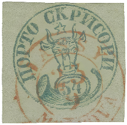

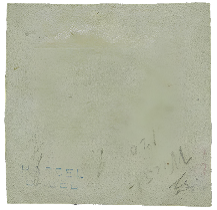

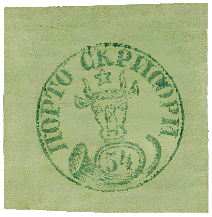

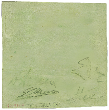

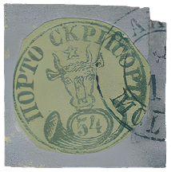

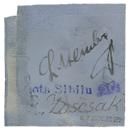

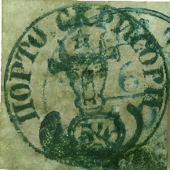

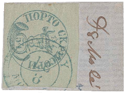

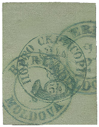

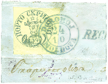

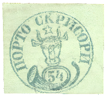

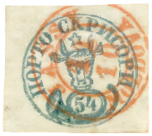

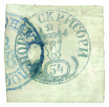

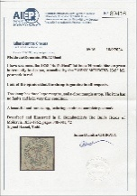

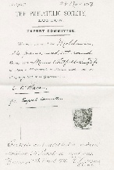

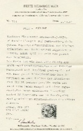

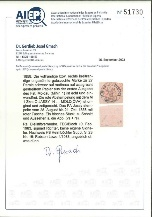

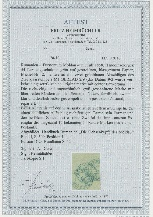

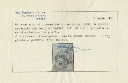

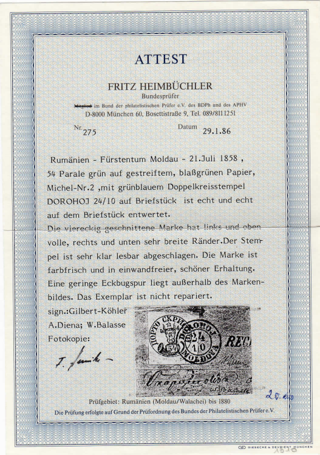

| Table 29: Figures ⏭ 54 Parale (§12) |  |  |  |
|---|---|---|---|
| Figure 236, p.271 | 54 Parale ⨀ M1 🌍 Iaşi (Jassy) 📅 23/9 | ⏭ 2024-10-19: https://auction.corinphila.ch/en/lot/4-A333-2430/ |  |
| Figure 236, p.271 | Reverse  ✍ Christine Hassel ✍ Todd |  |  |
| Figure 237, p.272 | 54 Parale ✾ 📅 1858 | ⏭ 2024-10-19: https://corinphila.ch/en/_auctions/&action=showLot&auctionID=24&lotno=1010 |  |
| Figure 237, p.272 | Reverse  ✍ Köhler  ✍ A. Diena ✍ E. Diena ✍ Heimbüchler BPP |  |  |
| Figure 238, p.272 | 54 Parale ✂ △ ⨀ M1 🌍 Bacău (Bakeu) 📅 8/10 | ⏭ 2024-11-18: https://corinphila.ch/en/_auctions/&action=showLot&auctionID=5&lotno=1706# |  |
| Figure 238, p.272 | Reverse  ✍ Rudolf Zoscsak ✍ Heimbüchler BPP |  |  |
| Figure 239, p.273 | 54 Parale ⨀ M1 🌍 Galaţi (Galatz) 📅 6/10 | ⏭ 2025-09-20: https://www.europeana.eu/en/item/2048047/Clasate_b536aa5d750c4151b0b4a222a9b63ee6 |  |
| Figure 240, p.273 | 54 Parale △ ⨀ M1 🌍 Iaşi (Jassy) 📅 18/8 | ⏭ 2025-09-18: https://corinphila.ch/de/_auctions/&action=showLot&auctionID=1&lotno=6029 |  |
| Figure 241, p.274 | 54 Parale ⨀ M1 🌍 Bârlad (Berlad) 📅 9/2 | ⏭ 2024-11-18: https://corinphila.ch/en/_auctions/?action=showLot&auctionID=3&lotno=5019 |  |
| Figure 242, p.275 | 54 Parale △ ⨀ M1 🌍 Dorohoi (Dorohoj) 📅 24/10 | ⏭ 2025-03-22: https://www.davidfeldman.com/dfsa-auctions/2013-september-auction-series/europe-overseas/70798/rarities-of-the-world-romania1858-54-parale-green/ |  |
| Figure 243, p.276 | 54 Parale ⨀ M1 |  |  |
| Figure 244, p.276 | 54 Parale ⨀ M1 🌍 Iaşi (Jassy) 📅 11/10 |  |  |
| Figure 245, p.276 | 54 Parale ⨀ M1 🌍 Focşani (Fokschani) 8/8 |  |  |
|  |  |  |  |
| Figure 246, p.277 | 📜 Cherata 📅 2024 | ⏭ Figure 236, p.271 |  |
| Figure 247, p.277 | 📜 Philatelic Society, Zoscsak 📅 1897, 1938 | ⏭ Figure 238, p.272 |  |
| Figure 248, p.277 | 📜 Heimbüchler 📅 1981 | ⏭ Figure 238, p.272 |  |
| Figure 249, p.277 | 📜 Gmach 📅 2022 | ⏭ Figure 196, p.253 |  |
| Figure 250, p.278 | 📜 Heimbüchler 📅 2010 | ⏭ Figure 241, p.274 |  |
| Figure 251, p.278 | 📜 Diena 📅 1964 | ⏭ Figure 241, p.274 |  |
| Figure 252, p.278 | 📜 Heimbüchler 📅 1986 | ⏭ Figure 242, p.275 |  |
