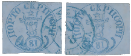
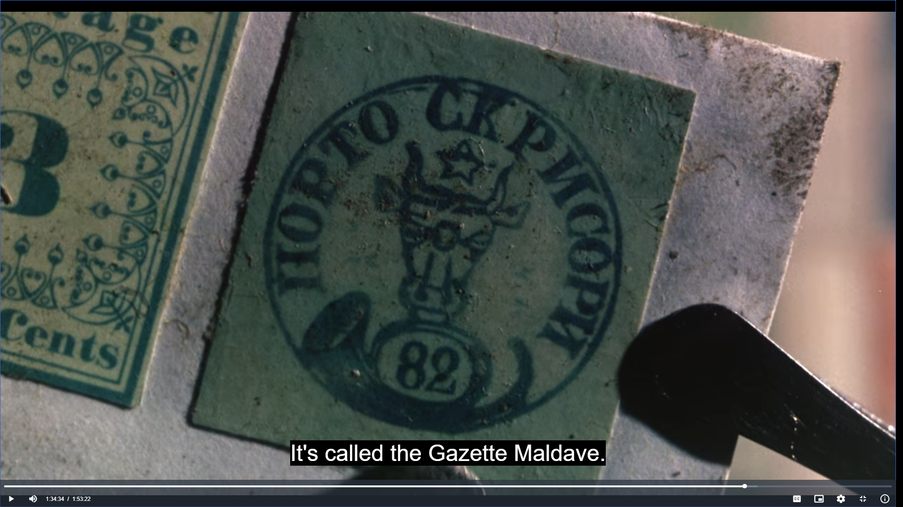

## Figures ⏭ 81 Parale (§13)

<!-- u:u02043 kind:table -->

| Table 30: Figures ⏭ 81 Parale (§13) |  |  |  |
|---|---|---|---|
| Figure 253, p.281 | 81 Parale ⨀ M1 🌍 Iaşi (Jassy) 📅 10/8 | ⏭ 2025-09-18: https://corinphila.ch/en/_auctions/&action=showLot&auctionID=3&lotno=5024# |  |
|  |  | ⏭ 2025-09-18: https://corinphila.ch/en/_auctions/&action=showLot&auctionID=24&lotno=1011# |  |
| Figure 259, p.286 | 81 Parale 🆁 Replica ⏭ Charade 📅 1963 | ⏭ 2025-09-18: https://en.wikipedia.org/wiki/File:Charade_(Stanley_Donen,_1963).webm |  |
| Figure 260, p.288 | 📖 SG AG 3523 📖 YT AG 4896 | ⏭ 2025-09-18: https://colnect.com/en/stamps/stamp/933338-Rare_stamps_of_the_world_-_Romania-Rare_Stamps_of_the_World-Antigua_and_Barbuda |  |
