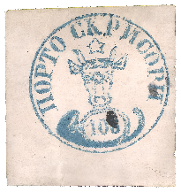
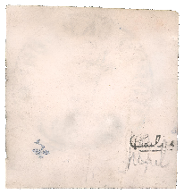
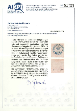

## Figures ⏭ 108 Parale (§14)

<!-- u:u02045 kind:table -->

| Table 31: Figures ⏭ 108 Parale (§14) |  |  |  |
|---|---|---|---|
| Figure 261, p.289 | 108 Parale ✳ | ⏭ 2024-12-31: https://www.davidfeldman.com/de/dfsa-auktionen/2022-december/hausman-collection-europe-overseas-latin-america-d/60366/romania-1858-108-parale-blue-on-horizontally-ribbe/ |  |
| Figure 261, p.289 | Reverse  ✍ |  |  |
| Figure 265, p.291 | 📜 Gmach 📅 2022 | ⏭ Figure 261 |  |
