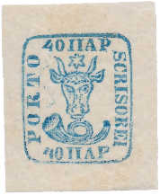
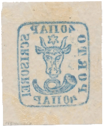

## Figures ⏭ 40 Parale (§19)

<!-- u:u02055 kind:table -->

| Table 36: Figures ⏭ 40 Parale (§19) |  |  |  |
|---|---|---|---|
| Figure 268, p.300 | 40 Parale ✳ | ⏭ 2025-09-27: https://www.ebay.com/itm/177439038596 |  |
| Figure 268, p.300 | Reverse  ✍ Pfenninger |  |  |
